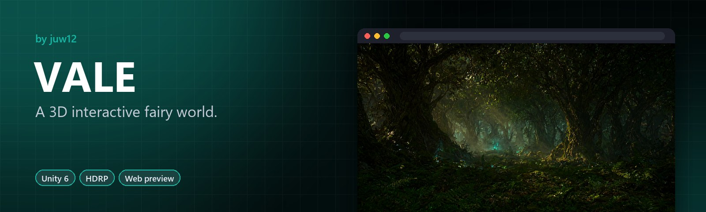

<!-- HERO:START -->
<p align="center">
  <a href="https://juw12.github.io/vale/"></a>
</p>

<p align="center">
  <b>A 3D interactive fairy world.</b><br>
  A first-person explorer: collect five Lumenshards to restore a fading fairy realm.
</p>

<p align="center">
  <a href="https://juw12.github.io/vale/"><b>Try it live</b></a> ·
  <a href="#see-it-in-action">See it in action</a> ·
  <a href="#highlights">Highlights</a> ·
  <a href="https://github.com/juw12">More by juw12</a>
</p>

<p align="center">
  <a href="https://github.com/juw12/vale"></a>
  <a href="https://juw12.github.io/vale/"></a>
  
  
  
</p>

<a id="highlights"></a>
<table>
  <tr>
    <td width="33%" valign="top">
      <b>Explore</b><br>
      First-person exploration of an ancient fairy realm.
    </td>
    <td width="33%" valign="top">
      <b>Five Lumenshards</b><br>
      Find them all to bring the light back.
    </td>
    <td width="33%" valign="top">
      <b>Unity 6 + HDRP</b><br>
      With an interactive HTML preview and five concept renders.
    </td>
  </tr>
</table>

## See it in action

<p align="center">
  <a href="https://juw12.github.io/vale/"></a><br>
  <sub>Open the interactive demo at <a href="https://juw12.github.io/vale/">juw12.github.io/vale/</a></sub>
</p>
<!-- HERO:END -->

## About

You wake at the edge of an ancient fairy realm whose light is fading. The Fairy
Elder asks you to recover five lost Lumenshards scattered across the Vale and
bring them to the Sacred Glade at its heart. Each shard is guarded by a fairy
keeper who will share a memory when spoken to. When all five shards are placed
on the Glade's altar, the Vale's light returns.

VALE is a first-person fairy explorer built on Unity 6 LTS with HDRP 17.2.
It is a small, polished prototype focused on atmosphere, collectible
exploration, and character dialogue.

---

## Features

- 🎮 First-person movement with a flight toggle (press F to glide through the canopy)
- 💎 Five Lumenshard collectibles hidden in cleared glades across the forest
- 👑 Fairy Elder quest giver at the Vale's entrance
- 🧚 Five fairy Keeper NPCs, each with unique dialogue and shard-area hints
- 🌳 Sacred Glade finale: place all five shards on the altar to restore the Vale
- 💾 Save/load system (JSON to persistent data path; auto-saves on focus loss)
- 🌲 Procedurally populated forest (editor script scatters trees and mushrooms)
- 🎬 Cinemachine 3 virtual camera with smooth follow and dead-zone

---

## Tech Stack

| Layer | Technology |
| --- | --- |
| Engine | Unity 6 LTS (6000.0.x) |
| Render pipeline | HDRP 17.2.0 |
| Input | New Input System (`com.unity.inputsystem` 1.11.2) |
| Camera | Cinemachine 3.1.0 |
| UI | UGUI + TextMeshPro |
| VFX | VFX Graph 17.2.0 (fairy dust particles) |
| Build tools | ProBuilder 6.0.0, Terrain Tools 5.0.0 |
| Language | C# (.NET Standard 2.1) |

---

## Quick start

1. **Install Unity.** Download Unity Hub from [unity.com](https://unity.com/download),
   then install Unity 6 (any `6000.0.x` LTS). Make sure the **High Definition RP**
   module is selected during installation. See [SETUP.md](SETUP.md) for details.

2. **Clone this repository.**
   ```bash
   git clone <your-repo-url> vale
   ```

3. **Open the project.** In Unity Hub click **Open**, then select the
   `apps/vale/` folder. The first open imports packages and can take 5 to 10
   minutes on a modern machine.

4. **Run the setup steps.** Follow [SETUP.md](SETUP.md) from start to finish.
   You will configure input, import free assets, create data assets, run four
   editor menu items to build the scene, and wire up the UI canvas. Total time:
   about 30 to 50 minutes depending on download speed.

   Once you are done, press **Play** in the editor and you will spawn at the
   Vale's entrance, able to walk (and fly) around the forest, talk to the
   Fairy Elder, and start the main quest.

---

## Controls

| Key | Action |
| --- | --- |
| W A S D | Move |
| Mouse | Look |
| Space | Jump |
| F | Toggle flight (glide) |
| Left Shift | Sprint |
| E | Interact (talk, pick up, place) |
| Tab | Toggle quest log |
| Escape | Pause menu |

---

## Project structure

```
apps/vale/
├── Packages/manifest.json
├── ProjectSettings/
│   ├── ProjectVersion.txt
│   └── PROJECTSETTINGS-NOTE.md
├── Assets/Vale/
│   ├── Scripts/
│   │   ├── Vale.Runtime.asmdef
│   │   ├── Core/          GameManager, SaveSystem, SceneController,
│   │   │                  InputManager, AudioManager
│   │   ├── Player/        PlayerController, PlayerFlight,
│   │   │                  PlayerInteraction, PlayerCamera
│   │   ├── Quests/        QuestManager, Quest, Objective, QuestData
│   │   ├── Dialogue/      DialogueRunner, DialogueData,
│   │   │                  DialogueLine, DialogueChoice
│   │   ├── Collectibles/  Collectible, Lumenshard, CollectibleManager,
│   │   │                  CollectibleData
│   │   ├── NPC/           NPCBase, FairyNPC, FairyElder, NPCWander, NPCData
│   │   ├── UI/            HUDController, QuestLogUI, DialogueUI,
│   │   │                  InteractionPromptUI, PauseMenuUI
│   │   ├── Audio/         AmbientAudioManager, FootstepPlayer,
│   │   │                  InteractionAudio
│   │   └── Editor/        Vale.Editor.asmdef, editor menu scripts
│   ├── Scenes/            FairyVale.unity
│   ├── Prefabs/           Player, FairyNPC, Lumenshard, Tree, Mushroom,
│   │                      SacredGlade, Altar
│   ├── Materials/         Lit, ShaderGraph, particle materials
│   ├── Audio/             BGM, SFX, ambient loops
│   └── Settings/          ValeInput.inputactions, HDRP volume profiles
├── README.md
├── SETUP.md
├── ARCHITECTURE.md
└── ASSETS.md
```

---

## Documentation index

| Document | What it covers |
| --- | --- |
| [SETUP.md](SETUP.md) | Step-by-step: install Unity, open the project, configure input and HDRP, import free assets, create data assets, run editor menu items, wire UI, press Play. The "I just cloned this" guide. |
| [ARCHITECTURE.md](ARCHITECTURE.md) | Codebase structure, namespace conventions, public interfaces, ScriptableObject schemas, manager singletons, save format. The "how it works" reference. |
| [ASSETS.md](ASSETS.md) | Every asset you need to download or import, with source URL, license, what it is used for, and install steps. |

---

## License

Code in this repository is licensed under the [MIT License](LICENSE).

Asset packs referenced in [ASSETS.md](ASSETS.md) (HDRP Starter Assets, Poly Haven
HDRIs, Kenney Nature Kit, freesound.org audio, etc.) carry their own licenses.
Each entry in ASSETS.md lists the applicable license. Make sure you comply with
those terms if you build on top of this project.

---

## Maintainer

[@juw12](https://github.com/juw12)
